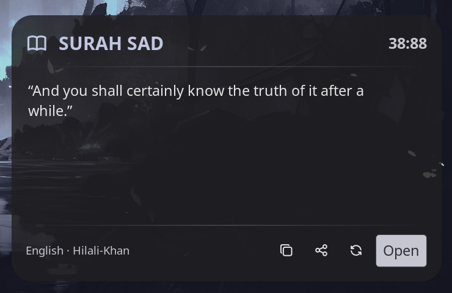
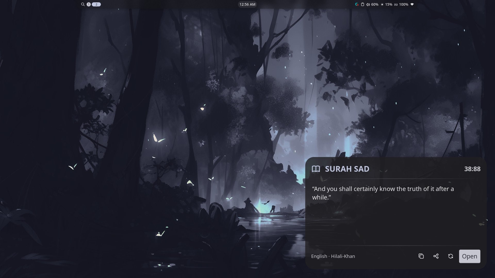
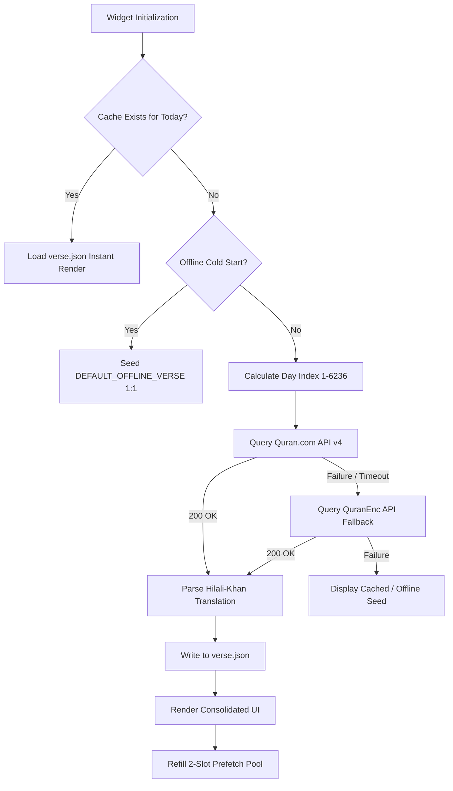

# Noctalia Quran Verse Widget

> A deterministic daily Quran verse widget for the Noctalia desktop shell with English Hilali-Khan translation, offline persistence, and random ayah exploration.

[](LICENSE)
[](plugin.toml)
[](https://quran.com)
[](plugin.toml)

---

## Table of Contents

- [Overview](#overview)
- [Key Features](#key-features)
- [Desktop Showcase](#desktop-showcase)
- [Usage](#usage)
- [Installation](#installation)
  - [Prerequisites](#prerequisites)
  - [Quickstart](#quickstart-automatic-installation)
  - [Manual Installation](#manual-installation)
- [Technical Architecture](#technical-architecture)
  - [Prefetch Pool & Caching Flow](#prefetch-pool--caching-flow)
  - [Directory Structure](#directory-structure)
- [Validation and Testing](#validation-and-testing)
- [Uninstallation](#uninstallation)
- [License](#license)

---

## Overview

Noctalia Quran Verse Widget is a native desktop widget for the Noctalia Wayland shell. It provides an uninterrupted spiritual anchor on Linux desktops by presenting a daily verse from the Quran paired with the authoritative English translation by Muhammad Taqi-ud-Din al-Hilali and Muhammad Muhsin Khan.

The widget renders inside a fixed 420x260 card, updates smoothly at midnight, retains full offline capability through local state caching and bundled fallbacks, and provides instant clipboard formatting for research and sharing.



---

## Key Features

- **Authoritative Translation**: Exclusively presents the scholarly Hilali-Khan translation sourced directly from Quran.com API (resource ID 203) with automatic secondary failover to QuranEnc.
- **Deterministic Calendar Sequence**: Maps every day of the calendar year to a distinct ayah across all 6,236 verses of the Quran, ensuring synchronized daily reading.
- **Instant Random Exploration**: Explore any verse across all 114 Surahs with 0ms perceived latency powered by a background prefetch pool, featuring a persistent "Back to Today" button to restore the daily sequence.
- **Offline-First Resilience**: Writes retrieved verses to local storage (`verse.json`) and bundles an in-memory seed verse (Surah Al-Fatihah 1:1) to guarantee immediate display even on fresh, offline cold starts.
- **BiDi-Safe Typography**: Sanitizes surrounding quotes, footnote superscripts, and parenthetical Arabic honorific calligraphy (`صلى الله عليه وسلم`) to ensure bidirectional rendering stability.
- **Fixed Layout Preservation**: Contains a responsive Luau scroll view that preserves the widget boundary (420x260 px) when displaying long passages like Ayat al-Dayn (2:282).
- **Consolidated Single-Row Footer**: Status attribution and dedicated controls share a clean, uncollided single horizontal row with zero layout clipping.
- **One-Click Share Citations**: Export clean plain text, formatted quote citations (`"..." Surah Sad 38:88 · Hilali-Khan`), or direct web references to the system clipboard.
- **Resource Efficient**: Operates on a dynamic event loop (30-second idle polling, 1.5-second transient banner decay) maintaining near-zero CPU and memory usage.

---

## Desktop Showcase

The widget integrates into Noctalia's native design system, supporting both dark and light system palettes:



---

## Usage

Interactive controls available on the widget interface:

| Control | Action | Target / Result |
| :--- | :--- | :--- |
| **Verse Body** | Click text area | Copies the plain English translation to clipboard |
| **Copy Icon** | Click | Copies the plain English translation to clipboard |
| **Share Icon** | Click | Copies formatted quotation with Surah name, Ayah reference, and translation credit |
| **Refresh Icon** | Click | Switches instantly to a random verse across all 114 Surahs (0ms response) |
| **Back to Today** | Click | Exits random mode and immediately restores today's scheduled verse |
| **Open Button** | Click | Launches the verse directly in your default browser via `xdg-open` |

---

## Installation

### Prerequisites

- **Noctalia** (version 5.0.0 or higher)
- **Linux Wayland Compositor** (Niri, Hyprland, Sway, River, or DWL)
- **xdg-open** (optional, required for the "Open" in browser button)

### Quickstart (Automatic Installation)

Clone the repository and run the automated installer:

```bash
git clone https://github.com/hamzzaqureshi/noctalia-quran-verse-widget.git
cd noctalia-quran-verse-widget
./install.sh -y
```

The script links the widget into Noctalia's local catalog, registers the source, enables the plugin, and launches Noctalia's interactive layout editor.

### Manual Installation

If you prefer configuring Noctalia manually:

1. Create the local plugins catalog directory:
   ```bash
   mkdir -p ~/.local/share/noctalia/sources/local-plugins
   ```

2. Register the catalog manifest in `~/.local/share/noctalia/sources/local-plugins/catalog.toml`:
   ```toml
   [[plugin]]
   id = "hamzzaqureshi/quran-verse"
   name = "Quran Verse"
   version = "1.0.0"
   author = "hamzzaqureshi"
   license = "MIT"
   icon = "book"
   description = "Daily Quran verse desktop widget with English Hilali-Khan translation and random verse exploration for Noctalia."
   plugin_api = 24
   tags = ["desktop", "language", "time", "utility"]
   ```

3. Symlink this repository into the catalog:
   ```bash
   ln -sfn "$(pwd)" ~/.local/share/noctalia/sources/local-plugins/quran-verse
   ```

4. Register the source and enable the widget in Noctalia:
   ```bash
   noctalia msg plugins source add local-plugins path ~/.local/share/noctalia/sources/local-plugins
   noctalia msg plugins enable hamzzaqureshi/quran-verse
   ```

5. Position the widget on your desktop:
   ```bash
   noctalia msg desktop-widgets-toggle-edit
   ```

---

## Technical Architecture

The widget executes inside Noctalia's sandboxed Luau runtime. Network queries execute asynchronously with automatic primary and secondary API failover:



### Prefetch Pool & Caching Flow

1. **Background Prefetch**: An in-memory queue maintains up to 2 pre-fetched random verses. Clicking the refresh icon consumes the queue immediately for a 0ms transition, then asynchronously refills the pool.
2. **Offline Fallback**: If network is disconnected on first run, the widget initializes with Surah Al-Fatihah 1:1, avoiding empty states or error crashes.
3. **Collision-Proof Geometry**: The footer row distributes available width deterministically, ensuring that action buttons and status strings never overlap.

### Directory Structure

```text
noctalia-quran-verse-widget/
├── .gitignore             # Ignores runtime cache and development type files
├── .luaurc                # Luau type checker configuration
├── LICENSE                # MIT License
├── README.md              # Project documentation
├── assets/
│   ├── desktop.png        # Full-screen desktop context screenshot (1920x1080)
│   └── preview.png        # Cropped high-resolution widget interface preview (740x480)
├── install.sh             # One-step automated installer
├── main.luau              # Primary widget logic and reactive UI implementation
├── plugin.toml            # Noctalia plugin manifest
├── tests/
│   └── test_edge_cases.lua # Edge case unit test suite
├── thumbnail.webp         # Official 960x540 catalog presentation card
└── uninstall.sh           # Clean removal and unregistration script
```

---

## Validation and Testing

To verify manifest conformance, type definitions, and catalog metadata against Noctalia's official rules:

```bash
noctalia plugins lint .
```

Expected output:

```text
hamzzaqureshi/quran-verse
  ok

0 errors, 0 warnings
```

To run the offline translation and typography unit tests:

```bash
lua tests/test_edge_cases.lua
```

Expected output:

```text
Test 1: Normal translation
  Pass: In the Name of Allah, the Most Beneficent, the Most Merciful.
Test 2: Surah Al-Mu'minun 23:72 with Arabic calligraphy
  Pass: Length 181 chars
Test 3: Footnotes and tags
  Pass: Some verse texttest.
All edge case unit tests PASSED
```

---

## Uninstallation

To cleanly unregister and remove the widget:

```bash
./uninstall.sh
```

This disables the plugin, removes the catalog symlink, and purges the empty local source definition.

---

## License

This project is licensed under the [MIT License](LICENSE).

Scripture text and translations remain the intellectual property of their respective publishers. English translation by Dr. Muhammad Taqi-ud-Din al-Hilali and Dr. Muhammad Muhsin Khan. APIs provided courtesy of [Quran.com](https://quran.com) and [QuranEnc.com](https://quranenc.com).
